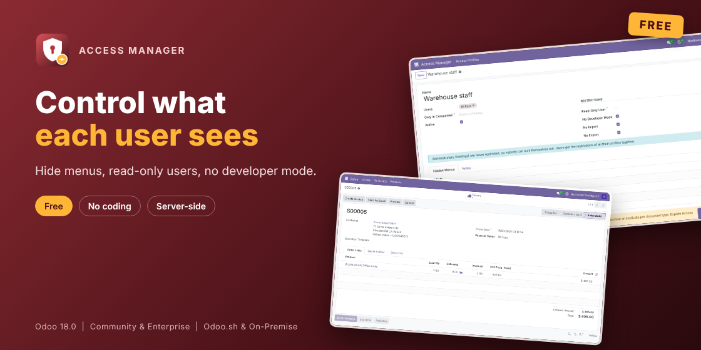

# Access Manager: Hide Menus & Read-Only Users (Odoo 18.0)

Control what each user sees in Odoo, without writing code. Group restrictions in access profiles and pick the users.

- **Hide menus**: whole apps, menus and sub-menus, per user.
- **Read-only users**: they see what they may see, without New, Edit or Delete. The server refuses changes too.
- **No developer mode, no import, no export** per profile.
- **Per company** if you like. Users get the restrictions of all their profiles together.
- **Administrators are never restricted**, so nobody can lock themselves out.

## Install

1. Copy `novator_access` into your addons path and install **Access Manager**.
2. Access Manager > Access Profiles > New. Name the profile and pick the users.
3. Tick read-only, no developer mode, no import or no export, and add the menus to hide.

## More

- Odoo Apps Store: https://apps.odoo.com/apps/modules/18.0/novator_access
- Fields, buttons and tabs, records by condition, create/edit/delete/archive/duplicate per document type, reports, Explain Access and profile export: [Access Manager Pro](https://apps.odoo.com/apps/modules/18.0/novator_access_pro)
- Support: support@novator.co, https://www.novator.co

## License

GNU Lesser General Public License v3 (LGPL-3). (c) Novator Technologies.
